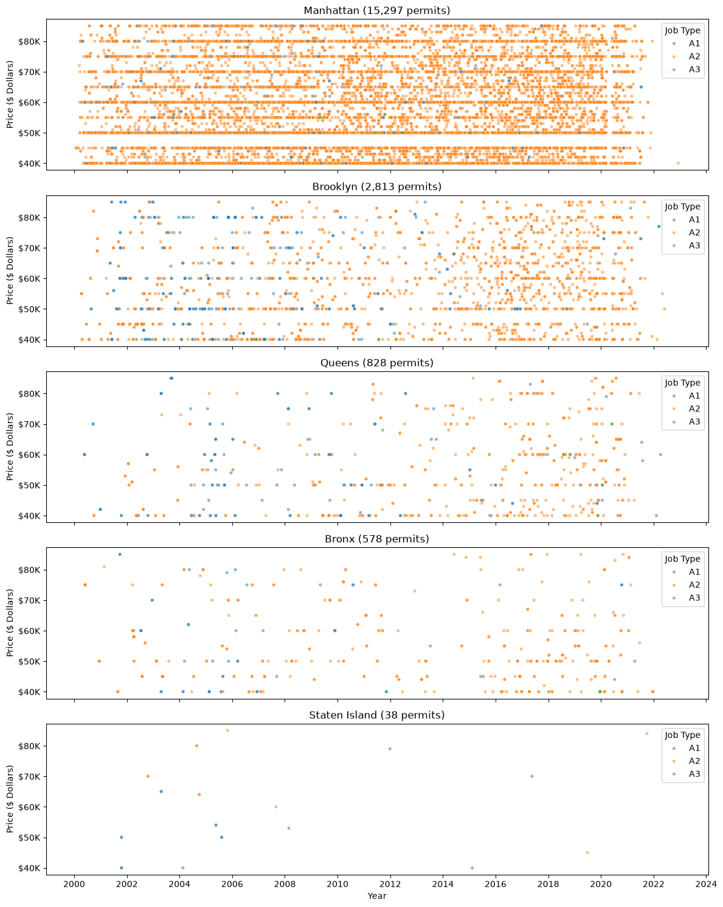
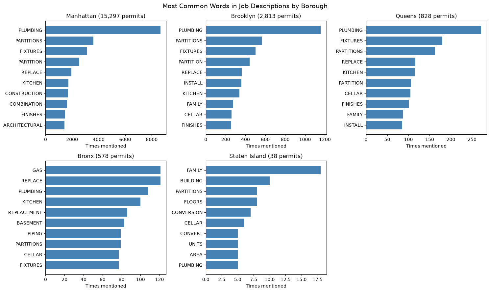

# group7_day1_assigment
Ugochinyere Megwa, Sneha Sachin Shenoy, Álvaro Miñé

**AI Methods I – Day 1: Data cleaning and EDA (IAAC MaAI 2026/27)**

## 03. Dataset
| | |
|---|---|
| **Name** | Housing Cost in New York |
| **Source** | [link](https://www.kaggle.com/datasets/anandaramg/apartment-cost-in-new-york-city?resource=download) |
| **Rows × columns (raw)** | 196313 x 18 |
| **Licence** | NYC OpenData  | 

## 03a. Project Overview

This project focuses on cleaning and exploring New York City housing related construction, permit and data using Python. The goal is to understand how the initial construction or renovation costs vary across the boroughs, job types, and permit years in New York.

The project uses data cleaning techniques and exploratory data analysis (EDA) to identify patterns, examine data quality, and communicate findings through data and visualizations.

## 04. Repository structure
```
New_York_Housing_cost/
├── data/
│   └── .gitkeep
├── figures/
│   └── .gitkeep
    └── .apartment_data.csv
    └── Graphs
└── notebook/
    └── data_cleaning_and_EDA.ipynb
├── .gitignore
├── LICENSE
├── README.md

...
```

## 05. How to Run

Follow the steps below to set up the project and run the exploratory data analysis (EDA) notebook.

### Step 1. Clone the Repository

A. Open the terminal and clone the GitHub repository on your Visual Studio Code:
```bash
git clone <your-github-repository-url>
```

B. Select and open the designated folder on your User Device: 
```bash
group7_day1_assignment
```


### Step 2. Create a Virtual Environment (Optional)

If needed create an isolated Python environment for the project:

**Windows (PowerShell):**

```powershell
python -m venv .venv
```

### Step 3. Open Notebook 
Under the New_York_Housing_Cost Folder

Find the file:
```bash
data_cleaning_and_EDA
```
## 06. Data Quality Summary 
| Category | What was found | Action taken |
|---|---|---|
| Missing values |  `Fully Permitted`: 3,977 | Ran a df.clean version in order to locate missing values |
| Missing values | `Zoning Dist1`: 2,094 | Ran a df.clean version in order to locate missing values |
| Duplicate rows | 6084 | Removed duplicates when appropriate and ran codes to verify |
| Initial Cost | Values required numeric conversion | Removed currency symbols and commas and converted to numeric values |
| Permit dates | `Invalid Permit Dates count`: 3977 | Converted dates and extracted permit years |
| Outliers | High or low costs were identified using IQR Method | Excluded flagged costs from selected plots where appropriate |

## 07. Key Findings

### Finding 1: Initial Cost by Borough and Job Type

The distribution of initial costs by borough and job type shows and compares initial project costs across Manhattan, Brooklyn, Queens, and the Bronx, with points coloured by job type (A1, A2, and A3).



### Finding 2: Most Common Words in Job Descriptions by Borough

This figure compares the most frequently mentioned words in housing permit job descriptions across New York City boroughs.



## 08. Limitations

- **Outliers:** Some unusually high or low costs may be valid projects. Removing them can affect summary statistics and visualizations.
- **Data quality:** The accuracy of the findings depends on the completeness and reliability of the original dataset.

## 09. AI Usage Disclosure

ChatGPT and Claude were used as an AI assistance tool during the development of this project.

- **Why:** To understand Python coding, data cleaning, exploratory data analysis, and data visualization.
- **Where:** During troubleshooting of Python codes, libraries, outlier detection using the IQR method, and improvement of scatterplots.
- **How:** ChatGPT and Claude provided code suggestions, explanations, and documentation examples. 

## 10. License
Code released under the NYC OpenData.